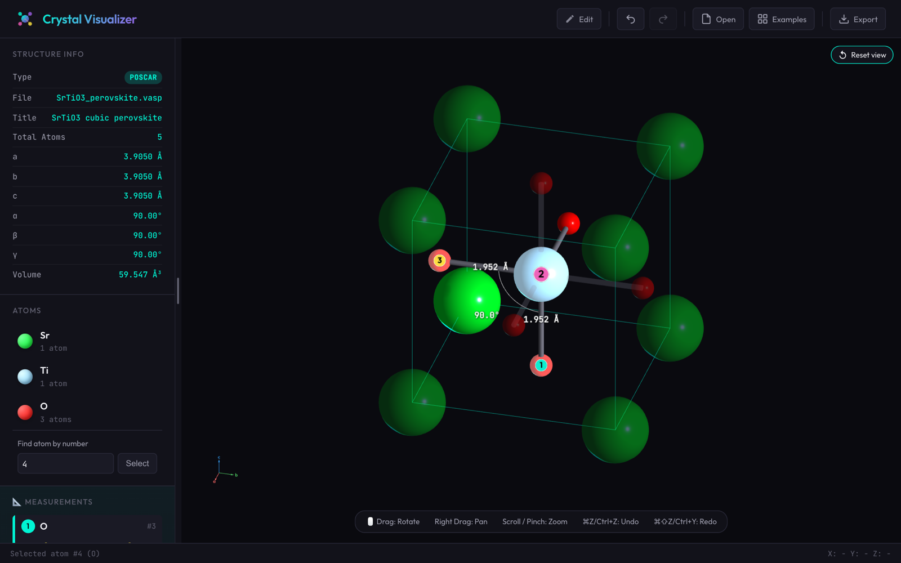

# Crystal Visualizer

View, measure and edit crystal structures in your browser: open a VASP POSCAR, XYZ or XDATCAR file and nothing needs installing.



**▶ [Try it in your browser](https://dicksonkam.github.io/crystal-visualizer/)** — drop a file onto the page or pick a built-in example.

## Features

- **Opens the files you already have.** VASP POSCAR/CONTCAR, plain and extended XYZ (with lattice and `pbc`), and XDATCAR trajectories with a playback timeline, all parsed in the browser; nothing is uploaded anywhere.
- **Shows the cell the way textbooks draw it.** Corner and face atoms appear as translucent periodic copies, bonds end where the cell does, and any number of periodic images or a full supercell is one click away.
- **Measures with a click.** Select up to three atoms for distances, fractional offsets and the angle between them, including to specific periodic copies.
- **Edits and exports.** Drag atoms or cell edges, type exact Cartesian or fractional coordinates, add, delete, shift and fix atoms, with full undo and redo, then export the structure back in its own format.
- **Makes figures.** VESTA element colours, element recolouring, light or dark backgrounds, PNG export at up to 4× with a transparent option, and MP4 movies of trajectories.

## Run locally

Clone or download the repository, serve the folder over HTTP, and open the local URL:

```sh
python3 -m http.server 8000
```

There is no build step and no server-side code. three.js (r128) and its TrackballControls ship under `vendor/three`, so a copy works without an internet connection; only the optional web fonts come from Google Fonts, and the page falls back to system fonts without them. The built-in examples use `fetch`, so opening `index.html` as a raw file will not load them.

## Documentation

- [Using the viewer](docs/using-the-viewer.md): navigation, periodic copies, measurements, editing, display options and the side panel.
- [File formats](docs/file-formats.md): exactly how POSCAR, XYZ and XDATCAR files are read, validated, and exported, plus image and movie export.
- [Camera contract](docs/camera.md): default view, fitting, snapping and gesture conventions.
- [Document and editing contract](docs/architecture.md): module layout, document state, editing rules and bounded geometry. Read it before adding an operation or format.
- [Tests](docs/testing.md): unit and browser suites, CI shards and the opt-in stress campaigns.

## Code and tests

The app is a static site. `app.js` adapts the pure modules (`geometry.js`, `document.js`, `formats.js`, `structure.js`, `history.js`, `camera.js`, `measurement.js`, `annotations.js`) to three.js and the DOM; the modules run under Node without a browser. Run the unit tests with `npm test`, and the Playwright browser suite with `npm run test:all` after `npm ci` and `npx playwright install chromium`. Details, including the stress campaigns, are in [docs/testing.md](docs/testing.md).

## How to cite

If Crystal Visualizer helped your work, please cite it. GitHub's "Cite this repository" button reads the metadata in [CITATION.cff](CITATION.cff); in plain form:

> Kam, D. (2026). *Crystal Visualizer* (Version 1.0.0) [Computer software]. https://github.com/DicksonKam/crystal-visualizer

A DOI for the archived release will be added here once it is published on Zenodo.

## License

[MIT](LICENSE) © 2026 Dickson Kam. three.js is © its authors under the MIT license (see `vendor/three/LICENSE`).
